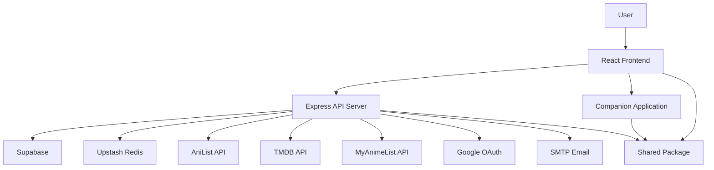

# 7Anime — Your Anime Universe

<p align="center">
  
</p>

<p align="center">
  <a href="https://github.com/bhimanijay89/7anime_new">
    
  </a>
  
  
  
</p>

<p align="center">
  <strong>Discover. Stream. Connect. Experience Anime.</strong>
  <br/>
  A modern anime discovery and streaming platform designed to bring your anime world together.
</p>

<p align="center">
  <a href="https://7anime-new.vercel.app">Website</a> •
  <a href="#-features">Features</a> •
  <a href="#-technology-stack">Tech Stack</a> •
  <a href="#-getting-started">Getting Started</a> •
  <a href="#-contributing">Contributing</a>
</p>

---

## ✨ About 7Anime

**7Anime** is a modern anime platform built around discovery, personalization, and an immersive viewing experience.

The goal is simple: create a place where anime fans can explore anime, discover new releases, manage their personal libraries, and enjoy their favorite shows through a polished and intuitive interface.

Built with a modular monorepo architecture, 7Anime separates its frontend, backend, shared contracts, and companion application into independent workspaces.

Whether you're discovering your next favorite series or watching together with friends, 7Anime aims to make your anime experience feel more connected.

## 🎬 Features

### Anime Discovery
- Explore and browse anime.
- Discover trending and recently released titles.
- Browse anime by genre.
- View anime details and artwork.
- Search for anime.
- Explore anime schedules.

### Personalized Experience
- Personal anime library.
- User profiles.
- Appearance and personalization settings.
- Authentication interface.
- Search and navigation experience.

### Watch Experience
- Dedicated anime watching interface.
- Episode-based navigation.
- Watch Together rooms.
- Shared viewing experience.

### Community & Engagement
- Watch Together functionality.
- Leaderboard.
- Chat drawer interface.
- Anime request and reporting dialogs.

> Features listed here reflect the frontend routes and components present in the repository. Availability of individual integrations and functionality may depend on backend configuration and implementation status.

## 🖼️ Screenshots

<p align="center">
  <i>Actual application screenshots will be added here.</i>
</p>

<!-- Replace these placeholders with actual screenshots from the application. -->

| Home Page | Anime Discovery |
|:---:|:---:|
| <!-- Add home screenshot --> | <!-- Add discovery screenshot --> |
| Watch Experience | Watch Together |
| <!-- Add player screenshot --> | <!-- Add watch-together screenshot --> |

## 🛠️ Technology Stack

### Frontend

<p>
  
</p>

| Technology | Purpose |
|---|---|
| React 19 | UI development |
| TypeScript | Type safety |
| Vite 8 | Development and build tooling |
| Tailwind CSS 4 | Styling |
| Zustand | State management |
| React Router 7 | Client-side routing |
| Lucide React | Icons |

### Backend

<p>
  
</p>

| Technology | Purpose |
|---|---|
| Node.js 22 | Runtime |
| Express 4 | API server |
| TypeScript | Backend development |
| Supabase | Authentication and data services |
| Upstash Redis | Distributed caching |
| Nodemailer | SMTP email transport |

### Companion Application

| Technology | Purpose |
|---|---|
| TypeScript | Application development |
| WebSocket (`ws`) | Real-time communication |
| Shared package | Common application contracts |

### External Integrations

- AniList — Anime metadata through its public API.
- TMDB — Movie and television metadata and artwork.
- MyAnimeList — Official API v2 integration.
- Supabase — Backend services.
- Upstash — Redis REST API.
- Google OAuth — Authentication integration.
- SMTP — Email delivery.

*Some integrations require their respective environment variables and credentials.*

## 🏗️ Project Architecture

7Anime follows a workspace-based monorepo architecture.

```text
7anime_new/
│
├── frontend/                  # React frontend
│   ├── src/
│   │   ├── components/        # Reusable UI components
│   │   ├── context/           # Application context
│   │   ├── pages/             # Application pages
│   │   ├── styles/            # Global styling
│   │   └── utils/             # Utility functions
│   └── package.json
│
├── backend/                   # Express backend
│   ├── src/
│   │   ├── config/            # Environment configuration
│   │   ├── routes/            # API routes
│   │   ├── services/          # Business logic and integrations
│   │   └── server.ts          # Server entry point
│   ├── .env.example
│   └── package.json
│
├── shared/                    # Shared TypeScript package
│
├── companion/                 # Companion application
│   ├── src/
│   └── package.json
│
├── package.json               # Root workspace configuration
└── README.md
```

### Architecture Overview



## 🚀 Getting Started

Want to run 7Anime locally? Follow these steps.

### Prerequisites

Make sure you have:

- Node.js `>=22 <23`
- npm with workspace support
- Git
- A code editor (VS Code recommended)

### 1. Clone the Repository

```bash
git clone https://github.com/bhimanijay89/7anime_new.git

cd 7anime_new
```

### 2. Install Dependencies

Install the root workspace dependencies:

```bash
npm install
```

### 3. Configure Environment Variables

Copy the example backend environment file:

```bash
cp backend/.env.example backend/.env
```

On Windows PowerShell:

```powershell
Copy-Item backend/.env.example backend/.env
```

Open `backend/.env` and configure the credentials you need.

### Environment Configuration

| Variable | Description |
|---|---|
| `PORT` | Backend server port |
| `NODE_ENV` | Application environment |
| `CORS_ORIGIN` | Allowed frontend origins |
| `SUPABASE_URL` | Supabase project URL |
| `SUPABASE_PUBLISHABLE_KEY` | Supabase publishable key |
| `UPSTASH_REDIS_REST_URL` | Upstash Redis URL |
| `UPSTASH_REDIS_REST_TOKEN` | Upstash Redis token |
| `TMDB_API_KEY` | TMDB API key |
| `TMDB_READ_ACCESS_TOKEN` | TMDB read access token |
| `MAL_CLIENT_ID` | MyAnimeList client ID |
| `MAL_CLIENT_SECRET` | MyAnimeList client secret |
| `GOOGLE_AUTH_CLIENT_ID` | Google Login OAuth client ID |
| `GOOGLE_AUTH_CLIENT_SECRET` | Google Login OAuth client secret |
| `GOOGLE_AUTH_REDIRECT_URI` | Google Login callback URL |
| `SMTP_HOST` | SMTP server host |
| `SMTP_PORT` | SMTP server port |
| `SMTP_USER` | SMTP username |
| `SMTP_PASSWORD` | SMTP application password |

Additional Gmail Mailer and branding variables are documented in `backend/.env.example`.

**Important:** Never commit `.env` files, passwords, API tokens, OAuth secrets, or other credentials to GitHub.

### 4. Start the Development Servers

Open separate terminals from the repository root.

**Terminal 1 — Backend**

```bash
npm run dev:backend
```

Default backend port:

```text
http://localhost:5000
```

**Terminal 2 — Frontend**

```bash
npm run dev:frontend
```

Default Vite development address:

```text
http://localhost:5173
```

**Terminal 3 — Companion Application (optional)**

```bash
npm run dev:companion
```

## 🔌 Backend API

The backend exposes its API through Express.

| Endpoint | Description |
|---|---|
| `GET /` | Backend gateway information |
| `GET /health` | Health check |
| `GET /api/health` | API health check |
| `GET /api/auth/status` | Authentication status |
| `GET /api/auth/config` | Authentication configuration |
| `GET /api/anime/search?q={query}` | Anime search |
| `GET /api/anime/{anilistId}` | Anime details |
| `GET /api/anime/{anilistId}/episodes` | Anime episodes |
| `GET /api/anime/{anilistId}/artwork` | Anime artwork |
| `GET /api/anime/{anilistId}/logo` | Anime logo |
| `GET /api/anime/trending` | Trending anime |

For the current implementation and response formats, refer to the backend route files.

## 📦 Production Build

Build all workspace applications:

```bash
npm run build
```

This runs the shared, backend, frontend, and companion build processes.

### Individual Builds

```bash
npm run build:shared
npm run build:backend
npm run build:frontend
npm run build:companion
```

### Run Production Backend

```bash
npm run start:backend
```

### Preview Frontend

```bash
npm run preview:frontend
```

### Type Checking

```bash
npm run typecheck
```

## 🔐 Security

Security and configuration are important parts of the project.

The backend includes:

- Security response headers.
- Disabled `X-Powered-By` header.
- Configurable CORS restrictions.
- Environment-based credentials.
- Sanitized integration diagnostics.
- Graceful server shutdown handling.
- Request body size limits.

Always use secure credentials and keep private configuration on the server side.

## 🗺️ Roadmap

The following are potential development directions, not a claim that these features are already implemented.

- [ ] Expand anime discovery and personalization.
- [ ] Improve the cinematic watch experience.
- [ ] Enhance Watch Together functionality.
- [ ] Expand companion application capabilities.
- [ ] Improve performance and caching.
- [ ] Expand accessibility and responsive design.
- [ ] Add comprehensive automated testing.
- [ ] Improve developer documentation.

## 🤝 Contributing

Contributions, suggestions, bug reports, and ideas are welcome!

If you would like to contribute:

1. Fork the repository.
2. Create a new feature branch.
3. Make your changes.
4. Test your changes locally.
5. Commit with a meaningful commit message.
6. Open a Pull Request.

```bash
git checkout -b feature/your-feature-name

git add .

git commit -m "feat: describe your changes"

git push origin feature/your-feature-name
```

Please keep changes focused, avoid committing secrets, and include relevant details in your Pull Request.

## 💜 Credits

Built with passion for anime and technology.

**Created and maintained by the 7Anime Team.**

<p align="center">
  <a href="https://github.com/bhimanijay89/7anime_new">
    
  </a>
  <a href="https://7anime-new.vercel.app">
    
  </a>
</p>

<p align="center">
  <strong>Made for anime lovers. Built with passion.</strong>
  <br/>
  <i>Welcome to your anime universe.</i>
</p>

<p align="center">
  
</p>
